<div align="center">

# Research Orchestrator Kit

### Researchers decide. Agents execute.

**From a research idea to an evidence-backed proposal and a blueprint video. Codex and Claude do the work inside a scope you approve once; you are asked only when a research decision is needed.**

[](https://github.com/yangyeontae-blip/research-orchestrator-kit/actions/workflows/verify.yml)


[한국어](README.md) · [Chat quick start](#try-it-first-get-a-proposal-through-conversation-in-codex) · [Video](#intro-video) · [Agent design](#agent-design-at-a-glance) · [Research flow](#research-flow) · [Get started](#get-started) · [CLI reference](docs/CLI-REFERENCE.md)

</div>

> **Language note.** The agent instructions, prompts, and most documents under `docs/` are written in Korean, because the tool targets Korean-language research proposals. This README is a full English guide to the same content as [README.md](README.md). Links marked *(Korean)* lead to Korean documents.

---

## Try it first: get a proposal through conversation in Codex

No install and no `rok` command needed. **Open this repository in Codex and say:**

```text
Following this repository's AGENTS.md, discuss my research idea with me, then draft a research proposal.
```

[`AGENTS.md`](AGENTS.md) is the agent. It assumes no default topic. When invoked it proceeds as follows.

| Step | What the agent does | Ends when |
|---|---|---|
| 0. Write check | Before the discussion, checks that it can write files. If not, tells you to restart with `codex --sandbox workspace-write`. | Writing works, or you have been told |
| 1. Key conditions | Asks one or two things at a time (up to three per round): research type (field study, thesis), submission format, participants, timeline. It never picks a format for you. | The needed conditions are collected |
| 2. Direction discussion | Offers 2-3 different research directions with trade-offs; you choose or combine them. | You choose a direction |
| 3. Question and method agreement | Summarizes research questions, participants, data, analysis, and ethics, and checks that questions, data, and analysis line up. | Your explicit agreement |
| 4. Proposal draft | Writes `workspace/<topic>/proposal-draft.md`. The appendix quotes your agreement in your own words and lists **unverified items**. | The eight-point self-check passes before output |

- Evidence not checked against the literature is marked `[미확인: 문헌 확인 필요]` (unverified: literature check needed). The agent never invents citations or numbers; without search access it writes a search plan (keywords, databases, inclusion criteria) instead.
- The model (`gpt-6.1-sol`) and reasoning effort (`high`) in [`.codex/config.toml`](.codex/config.toml) are recommendations. If they are unavailable, the agent says so and continues with an available model.
- Recorded runs on different topics, and how the instructions were refined, are in [`docs/demos/`](docs/demos/) *(Korean)*.
- Drafts that reflect real chat choices: [two live topics](examples/chat-proposal/live-two-topics-2026-10-13/README.md), a [synthetic education qualitative example](examples/chat-proposal/education-qualitative/README.md), a [synthetic health quantitative example](examples/chat-proposal/health-quantitative/README.md), and [how this path was developed and checked](docs/CHAT-PROPOSAL-DEVELOPMENT.md) *(all Korean)*.
- **Reproduction status:** in two separate fresh Codex CLI conversations, the questions and an answer-aware draft were confirmed, but saving the `.md` file failed because of the test host's read-only policy. The [run record](docs/records/CHAT-REPRODUCTION-2026-10-13.md) and a [researcher self-evaluation checklist](docs/CHAT-SELF-EVALUATION.md) are public *(Korean)*. A successful file save in a writable environment has not been recorded yet (see [`docs/CODEX-TODO.md`](docs/CODEX-TODO.md)), and a draft merely appearing in the chat is not treated as a successful save.
- If you also want literature collection, hash approvals, and independent review after the draft, continue with the full workflow (ROK) below. That part is optional.
- To continue a saved draft in the full workflow, run `rok init --profile <agreed-profile>` and then `rok import-plan workspace/<topic>/proposal-draft.md --sha256 <file-hash>`. An imported plan still goes through `validate`, use verification, and the collection-approval gate; importing is not itself an approval. See the [command guide](docs/CLI-REFERENCE.md).

---

## Intro video

https://github.com/user-attachments/assets/9dff1b4b-2aa1-4adc-8f84-1e53e637f918

<div align="center">

114 seconds · Korean narration and captions · synthetic example · [large-screen player](https://yangyeontae-blip.github.io/research-orchestrator-kit/video/player/) · [original MP4](https://github.com/yangyeontae-blip/research-orchestrator-kit/releases/download/v0.6.1/research-orchestrator-kit-v0.6.1.mp4)

</div>

Scene 7 was produced for real by this repository's blueprint renderer from a synthetic plan. The rest is code-made motion graphics; the narration is text-to-speech, and the music and sound effects are synthesized in code. Source and script are in [`docs/video/v0.6/`](docs/video/v0.6/).

## Agent design at a glance

ROK is a multi-agent orchestrator in which **tool-less LLM workers run inside a deterministic harness**.

| Who | Does what | Where |
|---|---|---|
| Model workers (study, research, review, video) | Write and propose judgments. They have no tools, shell, or approval rights; they receive approved text only and return schema-valid JSON. Codex runs with `--sandbox read-only`, Claude with `--tools ''`. | Plan drafts, independent review, citation proposals |
| Harness (code) | Literature search, open-access download, parsing, SHA-256 binding, quote-location checks, state transitions, resume, and limits are handled **in code**. ROK fills in hashes and plan sentences so a model never has to copy them. | `src/execution.mjs`, `src/evidence*.mjs` |
| Researcher | Decides at five gates only: scope, collection, revision items, use verification, `finalize`. | `rok authorize` … `rok finalize` |

- **Autonomy:** inside a scope approved once (input hashes, search terms, 12 worker calls, paid-API budget 0) it keeps going: collect, draft, independent review, and up to two supplementary collection rounds.
- **Stops:** it halts at every researcher gate, call limit, usage limit, hash mismatch, or missing required artifact, and keeps completed work.
- **Evidence:** a model-proposed citation counts as evidence only if the quote is actually on the cited page. In a seeded fault-injection run it rejected all 140 injected faults and none of 40 honest ledgers (a naive substring baseline caught 57% and wrongly rejected 50% of honest ones). Semantic support is not judged automatically.

Details: [agent design](docs/AGENT-DESIGN.md) · [autonomy policy](docs/AUTONOMY.md) · [evaluation](docs/EVALUATION.md#evidence-check-fault-injection-v070) *(Korean)*.

## Why this exists

However good AI tools get, researchers still spend time on chores such as:

- **moving files** between a study chat, a research chat, and a literature folder,
- **reconciling versions** such as `plan_final_REAL.docx`, and
- **reviving work** that stopped on an error or a usage limit.

Meanwhile the questions that matter get pushed back: *does this source really support this claim?* and *can this data answer this question?*

ROK hands file passing, version control, and error recovery to agents and returns the researcher's time to judgment.

## What changes

| | Feature | What it does |
|---|---|---|
| ✅ | **Approve once, then run** | Purpose and format, the files to send with their hashes, search terms, the tool, work limits, and a paid-API budget of zero are approved together; `rok run` then collects, drafts, and reviews. |
| 🤖 | **Agents that actually work** | Your already signed-in **Codex CLI** or **Claude Code** performs each task. Drafting and review run in separate sessions, so a self-assessment alone cannot pass. |
| 📄 | **From metadata to full text** | Crossref, OpenAlex, and KCI search, RIS/BibTeX import, Unpaywall open-access PDFs, title matching, and local parsing. Unavailable, scanned, or mismatched sources are never counted as success. |
| 🔎 | **Down to the page and sentence** | Claim → source → file hash → page and quote → support, contradiction, or context. A quote missing from the cited page is flagged as a mismatch. |
| 🎞️ | **Blueprint video from the plan** | Problem, purpose, questions, concepts, data, analysis, ethics, contribution, and limitations are extracted from the plan, shown with source lines; missing elements stay "unconfirmed". |
| 🛟 | **Stop and continue** | Usage limits, interruptions, and errors keep completed work; `rok resume` continues where it stopped. It never switches silently to a paid API. |
| 🧑‍⚖️ | **The researcher completes it** | The completion criterion is the researcher's `finalize`, not an external score. If a file changes, the finalization is automatically invalidated. |

## Research flow

```mermaid
flowchart LR
    A([Idea / study notes]) --> S{{Approve run scope}}
    S --> D[Exploratory collection]
    D --> P[Plan draft<br/>DOCX · quality report]
    P --> B[Blueprint video]
    B --> U{{Confirm plan}}
    U --> C{Collection approval<br/>plan SHA-256}
    C --> L[Focused collection<br/>full text · parsing]
    L --> R[Independent review<br/>evidence ledger]
    R --> V{Revision approval}
    V -- evidence missing --> C
    V --> X[Revised plan<br/>change-comparison video]
    X --> F{{Researcher finalizes<br/>finalize}}
    F --> Z([Final plan])

    classDef gate fill:#FBBF2422,stroke:#FBBF24,color:#FBBF24
    classDef run fill:#5EEAD41A,stroke:#5EEAD4,color:#5EEAD4
    class S,U,C,V,F gate
    class D,P,B,L,R,X run
```



Teal steps are run by agents inside the approved scope; the researcher is asked only at the yellow gates.

- Every handoff, artifact, and approval is bound to a file path and its **SHA-256**. If a plan changes by even one character, earlier approvals bound to that plan are not reused.
- **Exploratory collection** starts from an idea whose prior research is not yet organized; **focused collection** reinforces the exact version of a written plan and its weak evidence. Supplementary collection is limited to two rounds by default.
- The five roles (**lead planner, study, research, literature, video**) are unchanged. Only the lead planner creates the next stage's task.

## When the researcher decides

| When | What you decide |
|---|---|
| Run-scope approval | Purpose, format, deadline, the materials and search range sent to external tools, and work limits |
| Plan confirmation | A confirmer other than the drafter checks the key evidence and the question-data-analysis alignment directly |
| Collection approval | Permission to collect literature for the exact plan version |
| Revision approval | Choose which of the review report's proposed edits to apply, or reject them all |
| Supplementary collection | If evidence is still missing after two rounds: narrow the scope, change the question, or state the limitation |
| Finalization | After seeing the revised plan, evidence check, actual-use check, DOCX/HWPX comparison, and limitation record, run `finalize` |

ROK stops only when the research question or method changes, when a transfer or cost beyond the scope is needed, or when you adopt the final version. Criteria: [researcher judgment](docs/RESEARCHER-JUDGMENT.md) *(Korean)*.

## Get started

### 1. Install and check

```bash
git clone https://github.com/yangyeontae-blip/research-orchestrator-kit.git
cd research-orchestrator-kit
npm ci
npm link
rok doctor
```

`rok doctor` finds Codex CLI, Claude Code, and FFmpeg. Sign in to the two CLIs beforehand with their own login commands; ROK does not store credentials. Node.js 20 or newer is required.

### 2. Start and run

```bash
rok new          # idea · format (APA 7/JQI/generic) · method · deadline · sensitive data
rok authorize    # shows the run scope; type RUN to approve
rok run          # runs inside the approved scope and stops when a judgment is needed
rok status       # current stage and the next decision
```

At each stop, you decide:

```bash
rok verify-use <task-id>      # record only what you checked in the plan yourself
rok approve collection        # collection approval for the current plan hash
rok run                       # continue to the next judgment point
rok approve revision          # choose items to apply (you may reject all)
rok collect-more --gaps "..." # supplementary collection if evidence is missing
rok finalize --document docx  # researcher finalization
```

Use `rok stop` to interrupt and `rok resume` to continue. Approvals and finalization must be typed by a person, so they are refused from an agent's non-interactive shell.

### 3. Use it from a chat

Connect `rok bridge --root <work-folder>` to a lead-planner chat app and the researcher can approve the scope, run, and decide in chat without touching JSON. The host forwards only real user replies as confirmation records. See [chat execution](docs/chat-execution.md) *(Korean)*.

### 4. Blueprint video

```bash
rok blueprint                                  # blueprint of the current plan (with source lines)
rok blueprint --previous <previous blueprint.json>  # compare a revision with the earlier design
rok render <blueprint.json>                    # verify the blueprint hash, then type RENDER to render
rok preview <blueprint.mp4>                    # click to play · seek · download
```

Rendering runs after you approve the blueprint hash and needs the optional Remotion renderer (`npm ci --prefix docs/video/v0.5/remotion`). The video is a design drawing for the planning stage; it is never staged to look like research results.

<details>
<summary><b>Manual mode and legacy commands</b></summary>

You can also work without the runner. Use `rok next` to get a handoff message for any agent you like, then `rok finish <task-id>` to record the files actually produced.

```bash
rok next | finish <task-id> | validate | export --format docx|hwpx
rok literature search --query "..." | rok literature ingest <pdf|hwp|hwpx>
rok rework <task-id> --feedback "..." | release <task-id> | retry <task-id> --rebind | reopen --reason "..."
```

In `config.local.json` you can set a provider per role (`manual`, `codex`, `claude`, `openai_api`, `anthropic_api`). API adapters show the files to be sent and the sensitive-data scan result before every call and require you to type `SEND`. The full list is in the [CLI reference](docs/CLI-REFERENCE.md) *(Korean)*.

</details>

<details>
<summary><b>Evidence states</b></summary>

| Value | Meaning |
|---|---|
| `original_verified` | A person compared the original and the location |
| `parsed_verified` | Confirmed in the parsed text, but comparison with the original remains |
| `metadata_only` | Only the abstract or bibliographic data was checked; the body cannot be considered read |
| `unverified` | Not yet verified |

Automatic location matching, an AI's semantic judgment, and the researcher's confirmation are recorded in separate fields. PDF viewer page numbers and printed page numbers are also kept apart.

</details>

## Verification

```bash
npm run verify
```

This runs the full `node:test` suite, synthetic cases (APA 7 autoethnography, JQI interview, generic quantitative), the citation fault-injection evaluation (`npm run eval`), the npm package allowlist, and a full-Git-history privacy audit in one go. GitHub Actions runs the same checks on Ubuntu and Windows with Node.js 20 and 22, plus a formatting check (`npm run format:check`) and a non-blocking `npm audit`.

The earlier [run notes](docs/chat-execution.md#검증-수준) report two synthetic workflows with Claude Code and real Crossref, OpenAlex, and open-access full texts, from exploratory collection through draft, focused collection, independent review, revision, and finalization, with the human gates recorded under a synthetic operator name. Their raw state and event logs are not tracked in Git, so the [level of evidence](docs/records/NATIVE-RUN-EVIDENCE-2026-10-14.md) is written up separately. That audit also covers a new real Codex CLI run that saved a hash-checked plan file and stopped with automatic draft checks and human confirmation still pending. KCI was checked against the live server for missing and invalid keys; getting results with a valid key needs the researcher's own key.

## Repository layout

```text
research-orchestrator-kit/
├─ src/
│  ├─ engine.mjs            # state machine · hash binding · approval gates · recovery
│  ├─ lock.mjs              # project-wide state lock
│  ├─ execution.mjs         # run scope · Codex/Claude runners · stop/resume
│  ├─ bridge.mjs            # local JSONL bridge for chat hosts
│  ├─ literature.mjs · kci.mjs · bibliography.mjs · acquisition.mjs
│  │                        # search · Korean literature · bibliography import · open-access download
│  ├─ pdf.mjs · kordoc.mjs  # local PDF · HWP · HWPX parsing
│  ├─ evidence.mjs          # page and quote-location matching
│  ├─ blueprint.mjs · renderer/blueprint.jsx
│  │                        # blueprint extraction · video renderer · local player
│  ├─ privacy.mjs           # sensitive-data detection and redaction
│  ├─ quality.mjs · export.mjs
│  └─ cli.mjs
├─ profiles/   schemas/   prompts/
├─ examples/                # synthetic cases with no real research material
├─ tests/                   # node:test
└─ docs/                    # judgment criteria · design · CLI · verification · privacy · video sources
```

## What it does not do

- It never marks unread literature as read, and never invents experiences, results, citations, or page numbers.
- It does not bypass paywalls or institutional logins, collect without limit, run OCR, or generate HWP binaries.
- It does not switch to a paid API when a usage limit hits. The default paid-API budget is zero.
- It does not declare completion from an external or automatic score. The researcher decides when the work is complete.
- It keeps real proposals, study notes, paper full texts, chat IDs, and absolute paths out of the public repository.

## Documentation

| Document | Contents |
|---|---|
| [Researcher judgment](docs/RESEARCHER-JUDGMENT.md) | What is automatic, what the researcher decides, and the finalization criteria *(Korean)* |
| [Chat execution](docs/chat-execution.md) | Run scope, chat connection, and the level and limits of verification *(Korean)* |
| [CLI reference](docs/CLI-REFERENCE.md) | Every command and recovery procedures *(Korean)* |
| [Agent design](docs/AGENT-DESIGN.md) · [Autonomy policy](docs/AUTONOMY.md) | Roles, loops, the LLM/code boundary, autonomy limits, stop conditions *(Korean)* |
| [Architecture](docs/ARCHITECTURE.md) · [Design and implementation report](REPORT.md) | State model, approval binding, design decisions *(Korean)* |
| [Use verification](docs/USE-VERIFICATION.md) · [Evaluation scope](docs/EVALUATION.md) | How each artifact is checked and what the automatic checks cover *(Korean)* |
| [Cloud privacy](docs/CLOUD-PRIVACY.md) · [Privacy and copyright](docs/PRIVACY-COPYRIGHT.md) · [Security](SECURITY.md) | Data boundaries and rights |
| [Changelog](CHANGELOG.md) · [Third-party notices](THIRD_PARTY_NOTICES.md) | Per-version changes and licenses |

## Profiles and rights

| Profile | Purpose |
|---|---|
| `generic` | Journal-neutral proposal |
| `apa7` | APA Style 7th edition assignments and proposals (institution guidelines; student vs. professional manuscript) |
| `jqi` | Compatible with the format of the Korean Association for Qualitative Inquiry journal *Qualitative Inquiry* |

APA Style does not define one universal research-proposal outline, so the section structure is this tool's proposal. The JQI profile independently summarizes requirements checked against the [official submission rules](https://www.kaqi.or.kr/subList/32000001464). ROK is not affiliated with or endorsed by either organization, and it includes no manuals, sample documents, logos, or society templates. The optional video renderer, Remotion, follows its [own license](https://www.remotion.dev/license), separate from ROK's MIT license.

## Citation and license

If you use ROK in academic work, please cite it with [`CITATION.cff`](CITATION.cff). The MIT license covers this project's code and its own documentation only. The optional Remotion renderer has its own license. Third-party templates, papers, logos, music, and images belong to their owners. See [THIRD_PARTY_NOTICES.md](THIRD_PARTY_NOTICES.md).

<div align="center">
<br/>

**Judgment to the researcher. Execution to the agents.**

</div>
