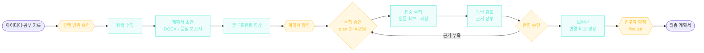

<div align="center">

# Research Orchestrator Kit

### 연구자는 판단하고, 에이전트는 실행한다

**연구 아이디어를 근거 있는 계획서와 설계도 영상까지. 실행은 Codex·Claude에게 맡기고, 연구자는 판단이 필요한 순간에만 결정합니다.**

[](https://github.com/yangyeontae-blip/research-orchestrator-kit/actions/workflows/verify.yml)


[소개 영상](#-소개-영상) · [무엇이 달라지나](#-무엇이-달라지나) · [연구 흐름](#-연구-흐름) · [연구자의 판단](#-연구자가-판단하는-순간) · [시작하기](#-시작하기) · [English](README.en.md)

</div>

---

## 🎬 소개 영상

https://github.com/user-attachments/assets/36a564eb-c83a-4041-b669-1b9d65dc9776

<div align="center">

97초 · 한국어 자막 · 합성 예시 · [큰 화면 플레이어](https://yangyeontae-blip.github.io/research-orchestrator-kit/video/player/) · [원본 MP4](https://github.com/yangyeontae-blip/research-orchestrator-kit/releases/download/v0.6.0/research-orchestrator-kit-v0.6.mp4)

</div>

7번째 장면은 이 저장소의 블루프린트 렌더러가 합성 계획서로 실제로 만든 화면입니다. 나머지는 코드로 만든 모션 그래픽이며 음악과 효과음도 코드로 합성했습니다. 소스와 대본은 [`docs/video/v0.6/`](docs/video/v0.6/)에 있습니다.

## 💡 왜 필요한가

AI 도구가 아무리 좋아져도, 연구자는 여전히 이런 일에 시간을 씁니다.

- 공부 채팅, 연구 채팅, 문헌 폴더 사이로 **파일을 옮기고**
- `계획서_최종_진짜.docx`처럼 갈라진 **버전을 맞추고**
- 사용량 한도나 오류로 **멈춘 작업을 되살리는** 일

그리고 정작 중요한 질문, 즉 *이 근거가 이 주장을 정말 뒷받침하는가*, *이 자료로 이 질문에 답할 수 있는가*는 뒤로 밀립니다.

ROK는 파일 전달·버전 관리·오류 복구를 에이전트에게 맡기고, 연구자의 시간을 판단에 돌려드립니다.

## ✨ 무엇이 달라지나

| | 기능 | 하는 일 |
|---|---|---|
| ✅ | **한 번 승인하면 실행** | 목적·형식, 보낼 파일과 해시, 검색어, 도구, 작업량 상한, 유료 API 0원을 한 번에 승인하면 `rok run`이 수집·작성·검토를 이어서 실행합니다. |
| 🤖 | **실제로 일하는 에이전트** | 이미 로그인한 **Codex CLI·Claude Code**가 작업합니다. 작성과 검토는 서로 다른 세션에서 하므로 자기평가만으로 통과하지 않습니다. |
| 📄 | **서지정보에서 원문까지** | Crossref·OpenAlex·KCI 검색, RIS·BibTeX 가져오기, Unpaywall 공개 원문 확보, 제목 일치 검사, 로컬 파싱. 접근 불가·스캔본·문헌 불일치는 성공으로 치지 않습니다. |
| 🔎 | **쪽과 문장까지** | 주장 → 문헌 → 파일 해시 → 쪽·인용 문장 → 지지·반박·맥락을 연결하고, 인용한 문장이 그 쪽에 없으면 불일치로 표시합니다. |
| 🎞️ | **계획서에서 설계도 영상** | 계획서에서 문제의식·목적·연구문제·개념·자료·분석·윤리·기여·한계를 뽑아 출처 행과 함께 영상으로 보여줍니다. 빠진 요소는 '미확인'으로 남습니다. |
| 🛟 | **멈춰도 이어서** | 사용량 한도·중단·오류가 나도 완료한 산출물은 남고 `rok resume`으로 멈춘 자리부터 다시 시작합니다. 유료 API로 몰래 넘어가지 않습니다. |
| 🧑‍⚖️ | **완료는 연구자가** | 외부 점수가 아니라 연구자의 최종 확정(`finalize`)이 완료 기준입니다. 파일이 바뀌면 확정은 자동으로 무효가 됩니다. |

## 🧭 연구 흐름



청록색 단계는 승인된 범위 안에서 에이전트가 이어서 실행하고, 노란색 관문에서만 연구자에게 묻습니다.

- 모든 인계·산출물·승인은 파일 경로와 **SHA-256**으로 묶입니다. 계획서가 한 글자만 바뀌어도 그 계획서에 묶인 이전 승인은 다시 쓰지 않습니다.
- **탐색 수집**은 아직 선행연구가 정리되지 않은 아이디어에서 출발하고, **집중 수집**은 작성된 계획서의 정확한 버전과 부족한 근거에 맞춰 보강합니다. 보완수집은 기본 두 차례까지입니다.
- 다섯 역할(**기획팀장·공부·연구·문헌·영상**)은 그대로 유지됩니다. 다음 단계 작업은 기획팀장만 만듭니다.

## 🧑‍⚖️ 연구자가 판단하는 순간

| 언제 | 무엇을 결정하나 |
|---|---|
| 실행 범위 승인 | 목적·형식·마감, 외부 도구로 보낼 자료와 검색 범위, 작업량 상한 |
| 계획서 확인 | 작성 담당과 다른 확인자가 핵심 근거와 연구문제–자료–분석 대응을 직접 확인 |
| 수집 승인 | 정확한 계획서 버전에 대해 문헌 수집을 허락 |
| 반영 승인 | 검토 보고서의 수정 제안 중 반영할 항목을 고르거나 모두 반려 |
| 보완수집 여부 | 두 차례 보완 뒤에도 근거가 없으면 범위 축소·질문 변경·한계 명시 중 선택 |
| 최종 확정 | 보완본·근거 검사·실사용 확인·DOCX/HWPX 대조·한계 기록을 보고 `finalize` |

연구문제나 방법이 바뀌거나, 범위를 넘는 전송·비용이 필요하거나, 최종본을 채택할 때만 멈춥니다. 자세한 기준은 [연구자의 판단](docs/RESEARCHER-JUDGMENT.md)에 있습니다.

## 🚀 시작하기

### 1. 설치와 점검

```bash
git clone https://github.com/yangyeontae-blip/research-orchestrator-kit.git
cd research-orchestrator-kit
npm ci
npm link
rok doctor
```

`rok doctor`는 Codex CLI·Claude Code·FFmpeg를 찾습니다. 두 CLI는 각자의 로그인 명령으로 미리 인증해 두십시오. ROK는 인증 정보를 저장하지 않습니다.

### 2. 연구 시작과 실행

```bash
rok new          # 아이디어 · 형식(APA 7/JQI/generic) · 방법 · 마감 · 민감정보
rok authorize    # 실행 범위를 보여주고 RUN 입력으로 승인
rok run          # 승인된 범위 안에서 실행하고, 판단이 필요하면 멈춤
rok status       # 지금 단계와 다음에 결정할 일
```

멈춘 지점에서 연구자가 결정합니다.

```bash
rok verify-use <task-id>      # 계획서를 직접 확인한 내용만 기록
rok approve collection        # 현재 계획서 해시에 대한 수집 승인
rok run                       # 다음 판단 지점까지 이어서 실행
rok approve revision          # 반영할 항목 선택 (모두 반려 가능)
rok collect-more --gaps "..." # 근거가 부족하면 보완수집
rok finalize --document docx  # 연구자 최종 확정
```

중단되면 `rok stop`, 다시 시작은 `rok resume`입니다. 승인과 확정은 사람이 직접 입력해야 하므로 에이전트의 비대화형 셸에서는 거부됩니다.

### 3. 채팅에서 쓰기

기획팀장 채팅 앱에 `rok bridge --root <작업폴더>`를 연결하면, 연구자는 JSON을 만지지 않고 채팅에서 범위 승인·실행·결정을 할 수 있습니다. 호스트는 실제 사용자 응답만 확인 기록으로 전달합니다. [채팅 연결 안내](docs/chat-execution.md)

### 4. 블루프린트 영상

```bash
rok blueprint                                  # 현재 계획서의 설계도 (출처 행 포함)
rok blueprint --previous <이전 blueprint.json>  # 보완본과 이전 설계 비교
rok render <blueprint.json>                    # 블루프린트 해시 확인 후 RENDER 입력으로 렌더링
rok preview <blueprint.mp4>                    # 클릭 재생 · 구간 이동 · 다운로드
```

영상 렌더링은 블루프린트 해시를 승인한 뒤 실행되며, 선택형 Remotion 렌더러(`npm ci --prefix docs/video/v0.5/remotion`)가 필요합니다. 영상은 계획 단계의 설계도이며 연구 결과처럼 연출하지 않습니다.

<details>
<summary><b>수동 모드와 기존 명령</b></summary>

실행기 없이도 기존 방식으로 쓸 수 있습니다. `rok next`로 인계 메시지를 받아 원하는 에이전트에게 전달하고, `rok finish <task-id>`로 실제 만든 파일을 기록합니다.

```bash
rok next | finish <task-id> | validate | export --format docx|hwpx
rok literature search --query "..." | rok literature ingest <pdf|hwp|hwpx>
rok rework <task-id> --feedback "..." | release <task-id> | retry <task-id> --rebind | reopen --reason "..."
```

`config.local.json`에서 역할별 provider(`manual`·`codex`·`claude`·`openai_api`·`anthropic_api`)를 정할 수 있습니다. API 어댑터는 매 호출 전 전송 파일과 민감정보 탐지 결과를 보여주고 `SEND` 입력을 받습니다. 전체 목록은 [CLI 참조](docs/CLI-REFERENCE.md)에 있습니다.

</details>

<details>
<summary><b>근거 상태</b></summary>

| 값 | 의미 |
|---|---|
| `original_verified` | 사람이 원문과 위치를 대조함 |
| `parsed_verified` | 파싱 본문에서 확인했으나 원문 대조가 남음 |
| `metadata_only` | 초록·서지정보만 확인함. 본문을 읽었다고 볼 수 없음 |
| `unverified` | 검증 전 |

자동 위치 대조, AI의 의미 판단, 연구자의 확인은 서로 다른 필드에 기록됩니다. PDF 화면 쪽수와 인쇄 쪽수도 구분합니다.

</details>

## 🧪 검증

```bash
npm run verify
```

테스트 83개, 합성 사례(APA 7 자문화기술지·JQI 면담·범용 양적 연구), npm 패키지 허용목록, 전체 Git 이력 개인정보 감사를 한 번에 실행합니다. GitHub Actions는 Ubuntu·Windows × Node.js 20·22에서 같은 검증을 돌립니다.

실제 계정으로는 Codex CLI(공부 작업)와 Claude Code(아이디어 → 계획서 → 확인 관문에서 정지)를 확인했고, 블루프린트 영상 렌더링도 확인했습니다. 이 과정에서 산출물 종류 표기 오류, Windows npm 설치본 인식 문제, 실패 기록에 프롬프트가 남는 문제를 찾아 고쳤습니다. KCI 실제 계정 호출과 모든 단계를 실제 모델로 끝까지 돌리는 검증은 아직이며, [채팅 실행 안내](docs/chat-execution.md#검증-수준)에 범위를 구분해 기록했습니다.

## 🗂️ 저장소 구조

```text
research-orchestrator-kit/
├─ src/
│  ├─ engine.mjs            # 상태 기계 · 해시 결속 · 승인 관문 · 복구
│  ├─ execution.mjs         # 실행 범위 · Codex/Claude 실행기 · 중단/재개
│  ├─ bridge.mjs            # 채팅 호스트용 로컬 JSONL 연결
│  ├─ literature.mjs · kci.mjs · bibliography.mjs · acquisition.mjs
│  │                        # 검색 · 국내 문헌 · 서지 가져오기 · 공개 원문 확보
│  ├─ pdf.mjs · kordoc.mjs  # 로컬 PDF · HWP · HWPX 파싱
│  ├─ evidence.mjs          # 쪽 · 인용 위치 대조
│  ├─ blueprint.mjs · renderer/blueprint.jsx
│  │                        # 블루프린트 추출 · 영상 렌더러 · 로컬 플레이어
│  ├─ quality.mjs · export.mjs
│  └─ cli.mjs
├─ profiles/   schemas/   prompts/
├─ examples/                # 실제 연구자료 없는 합성 사례
├─ tests/                   # node:test 83개
└─ docs/                    # 판단 기준 · 설계 · CLI · 검증 · 개인정보 · 영상 소스
```

## 🚧 하지 않는 일

- 읽지 않은 문헌을 읽었다고 표시하거나, 경험·결과·인용·쪽수를 만들지 않습니다.
- 유료벽·기관 로그인 우회, 무제한 수집, OCR, HWP 바이너리 생성을 하지 않습니다.
- 사용량 한도에 걸려도 유료 API로 자동 전환하지 않습니다. 유료 API 예산 기본값은 0원입니다.
- 외부 점수나 자동 점수로 완료를 선언하지 않습니다. 완료는 연구자가 정합니다.
- 실제 계획서, 학습 기록, 논문 원문, 채팅 ID, 절대 경로를 공개 저장소에 넣지 않습니다.

## 📖 문서

| 문서 | 내용 |
|---|---|
| [연구자의 판단](docs/RESEARCHER-JUDGMENT.md) | 자동으로 하는 일과 연구자가 정하는 일, 최종 확정 기준 |
| [채팅 실행](docs/chat-execution.md) | 실행 범위, 채팅 연결, 검증 수준과 한계 |
| [CLI 참조](docs/CLI-REFERENCE.md) | 모든 명령과 복구 절차 |
| [아키텍처](docs/ARCHITECTURE.md) · [설계·구현 보고서](REPORT.md) | 상태 모델, 승인 결속, 설계 결정 |
| [실사용 검증](docs/USE-VERIFICATION.md) · [검증 범위](docs/EVALUATION.md) | 산출물별 확인 방법과 자동 검사의 범위 |
| [클라우드 개인정보](docs/CLOUD-PRIVACY.md) · [개인정보·저작권](docs/PRIVACY-COPYRIGHT.md) · [보안](SECURITY.md) | 데이터 경계와 권리 |
| [변경 기록](CHANGELOG.md) · [제3자 고지](THIRD_PARTY_NOTICES.md) | 버전별 변경과 라이선스 |

## 📐 프로필과 권리 범위

| 프로필 | 용도 |
|---|---|
| `generic` | 학술지 중립 계획서 |
| `apa7` | APA Style 7판 과제·계획서 (제출기관 지침, 학생/전문 원고 구분) |
| `jqi` | 한국질적탐구학회 『질적탐구』 형식 호환 |

APA Style은 하나의 보편적 연구계획서 목차를 정하지 않으므로 장 구성은 이 도구의 제안입니다. JQI 프로필은 [공식 투고규정](https://www.kaqi.or.kr/subList/32000001464)을 확인해 요건을 독립적으로 요약했습니다. 두 기관과 제휴하거나 승인받은 도구가 아니며, 매뉴얼·견본·로고·학회 양식을 포함하지 않습니다. 선택형 영상 렌더러인 Remotion은 ROK의 MIT 라이선스와 별개인 [자체 라이선스](https://www.remotion.dev/license)를 따릅니다.

## 📝 인용과 라이선스

학술 작업에 사용했다면 [`CITATION.cff`](CITATION.cff)로 인용해 주십시오. MIT 라이선스는 이 프로젝트의 코드와 자체 문서에만 적용됩니다.

<div align="center">
<br/>

**판단은 연구자에게. 실행은 에이전트에게.**

</div>
