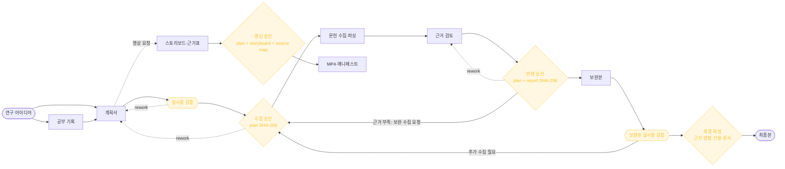

<div align="center">

# Research Orchestrator Kit

**연구 아이디어에서 계획서, 문헌 근거, 보완본까지. 각 산출물과 승인을 버전별 해시로 연결하는 로컬 우선 연구 오케스트레이터**

[](https://github.com/yangyeontae-blip/research-orchestrator-kit/actions/workflows/verify.yml)


[소개 영상](#-소개-영상) · [핵심 아이디어](#-핵심-아이디어) · [작동 방식](#-작동-방식) · [10분 시작](#-10분-시작) · [문서](#-문서) · [English](README.en.md)

</div>

## 실행 시스템 개발 프리뷰

`v0.6.0-alpha.1`은 기존 수동 흐름을 유지하는 개발 프리뷰입니다. `rok doctor`로 도구 설치를 확인하고, 호스트가 `rok bridge --root <작업폴더>`를 연결하면 연구자가 채팅에서 범위와 버전을 승인할 수 있습니다. 연결은 자동 설치되지 않습니다.

아이디어 → 승인된 탐색 → 초안·DOCX·블루프린트 → 사람 확인 → 집중 수집·파싱 → 독립 검토 → 반영 승인 → 보완본으로 진행합니다. 영상은 별도 승인한 블루프린트에서 생성하고 로컬 플레이어에서 재생합니다. 현재 실행기는 영상 작업을 자동 완료하지 않으며, 별도 렌더링과 실제 사용 확인이 필요합니다.

승인 범위 기반 `run/resume/stop`, 네이티브 Codex·Claude 실행, 공개 원문 확보, 근거 위치 검증, 연구 블루프린트 생성·영상 렌더링을 추가했습니다. **외부 사용자 검증을 마친 정식 릴리스는 아닙니다.** [설정·채팅 연결·현재 한계](docs/chat-execution.md)를 확인하세요.

---

## 🎬 소개 영상

https://github.com/user-attachments/assets/547d2e3b-6de2-466d-bc64-be61550bb635

<div align="center">

98초 · 한국어 나레이션·자막 · [큰 화면 플레이어](https://yangyeontae-blip.github.io/research-orchestrator-kit/video/player/) · [원본 MP4](https://github.com/yangyeontae-blip/research-orchestrator-kit/releases/download/v0.5.0/research-orchestrator-kit-v0.5.mp4)

</div>

영상은 도구가 상태를 다루는 방식을 합성 예시로 보여줍니다. 실제 연구 결과가 아닙니다. 모든 장면은 코드로 만든 모션 그래픽이고, 나레이션은 TTS, 배경음과 효과음은 FFmpeg으로 합성했습니다. 소스·대본·자막·빌드 스크립트는 [`docs/video/v0.5/`](docs/video/v0.5/)에 있습니다.

## 💡 왜 필요한가

생성형 AI로 연구를 보조할 때 실제로 무너지는 지점은 모델의 능력이 아니라 **버전과 책임**입니다.

- `계획서_최종_진짜.docx`처럼 버전이 갈라지면, 어떤 문헌이 어떤 계획서를 뒷받침하는지 아무도 확신할 수 없습니다.
- 채팅 기억에 기대면 다음 에이전트가 어떤 파일과 결정을 이어받았는지 재현할 수 없습니다.
- 승인이 버전에 묶이지 않으면, 고친 계획서로 예전 승인이 그대로 쓰입니다.

Research Orchestrator Kit은 이 문제를 **파일, SHA-256, 사람의 명시적 승인**으로 풉니다.

## ✨ 핵심 아이디어

| | 원칙 | 구현 |
|---|---|---|
| 🔗 | **모든 것은 해시에 묶인다** | 인계·receipt·승인마다 입력 파일 경로와 SHA-256을 기록합니다. 계획서가 한 글자만 바뀌어도 이전 승인은 무효가 됩니다. |
| 🧑‍⚖️ | **판단은 사람이 한다** | 수집·반영·영상 승인과 실사용 검증은 사람이 결정합니다. 대화형 터미널 또는 실제 사용자 응답을 전달하는 신뢰된 로컬 채팅 연결을 사용합니다. |
| 📚 | **근거 상태를 숨기지 않는다** | 모든 주장은 `원문 확인`·`파싱 확인`·`메타데이터만`·`미확인` 중 하나로 남습니다. 자동 검사, AI 평가, 사람 평가는 다른 필드입니다. |
| 🛟 | **막다른 길이 없다** | 재작업 요청, 작업 회수(lease), `--rebind` 재시도, 남은 잠금 자동 정리로 어떤 상태에서도 다음 행동이 있습니다. |
| 🏠 | **로컬이 기본이다** | PDF·HWP·HWPX는 로컬에서만 읽습니다. 기존 API 어댑터는 매 호출 `SEND` 확인을 받습니다. 새 네이티브 CLI는 승인된 범위의 텍스트를 전송합니다. |

## 🧭 작동 방식

### 다섯 역할

| 역할 | 담당 |
|---|---|
| **기획팀장** (orchestrator) | 상태, 인계, 승인 관문, 오류 재개. 다음 단계 작업은 기획팀장만 만듭니다. |
| **공부** 에이전트 | 학습 지원, 공부 기록, 연구 연결 제안 |
| **연구** 에이전트 | 계획서, 근거 검토, 승인된 항목만 반영한 보완본 |
| **문헌** 에이전트 | Crossref·OpenAlex·선택형 KCI 검색, 공개 원문 확보, 중복 제거, PDF·HWP·HWPX 로컬 파싱 |
| **영상** 에이전트 | 연구 흐름 스토리보드, 장면별 근거표, 승인된 영상 렌더링 |

에이전트는 Codex, Claude, OpenAI·Anthropic API, 사람 중 무엇이든 될 수 있습니다. 모두 같은 파일 기반 인계와 receipt 형식을 씁니다.

### 상태 흐름



- **관문(◇)** 은 사람이 승인한 정확한 해시에서만 열립니다. 계획서가 바뀌면 그 계획서에 묶인 수집 승인과 영상 승인은 자동으로 무효가 됩니다.
- **산출물 수준**은 `generated` → `automated_verified` → `use_verified` 세 단계입니다. 계획서는 실제로 사용해 확인한 기록이 있어야 수집 관문으로 넘어갑니다.
- **영상 가지**는 선택 사항이며 연구계획서 흐름을 막지 않습니다.
- **보완 수집**은 검토 보고서에서 드러난 근거 공백을 `rok collect-more`에 명시하면 같은 계획서 해시로 수집 승인을 다시 받고 시작합니다. 앞서 확보한 문헌은 보존하고 새 문헌과 함께 다시 근거를 검토합니다.
- **최종 확정**은 보완본의 근거·방법·인용 자동검사와 사람의 계획서 사용 검증, DOCX/HWPX의 실제 열람·레이아웃·내용 대조, 남은 한계 기록을 마친 뒤 연구자가 `rok finalize`로 결정합니다. 학술 심사 통과를 뜻하지 않습니다.

### 막혔을 때의 길

| 상황 | 명령 | 동작 |
|---|---|---|
| 계획서·검토 보고서·스토리보드를 고쳐야 함 | `rok rework <task> --feedback "..."` | 피드백을 결정 기록에 남기고 같은 입력으로 새 작업을 엽니다 |
| 검토 결과 근거가 부족함 | `rok collect-more --gaps "공백 1,공백 2"` → `rok approve collection` | 공백과 검토 보고서 해시를 새 수집 작업에 묶고, 기존 문헌을 보존한 채 재검토합니다 |
| 확정 뒤 새 근거나 수정이 생김 | `rok reopen --reason "..."` | 최종 확정 기록을 이력에 남기고 변경된 계획서는 재평가합니다 |
| 에이전트가 응답 없이 사라짐 | `rok release <task>` → `rok retry <task>` | 작업을 실패로 회수합니다. lease(기본 72시간)가 지나면 같은 역할의 다음 작업이 가져갑니다 |
| 작업 중 입력 파일이 바뀜 | `rok retry <task> --rebind` | 바뀐 입력만 다시 해시합니다. 승인에 묶인 계획서·보고서는 다시 묶지 않습니다 |
| 비정상 종료로 `state.lock`이 남음 | 아무 명령 | 죽은 프로세스의 잠금이나 2분 넘은 잠금을 자동으로 정리합니다 |

## 🚀 10분 시작

```bash
git clone https://github.com/yangyeontae-blip/research-orchestrator-kit.git
cd research-orchestrator-kit
npm ci
npm link          # 싫다면 rok 대신 node src/cli.mjs
```

```bash
rok new                                   # 아이디어 · 형식(APA 7/JQI/generic) · 방법 · 마감 · 민감정보
rok next                                  # 다음 작업을 담당 에이전트에게 인계
rok finish <task-id>                      # 실제로 만든 파일만 입력하면 해시를 확인해 기록
rok validate                              # 품질 보고서 생성 (계획서 해시에 묶임)
rok verify-use <task-id>                  # 사람이 직접 확인한 내용만 기록
rok approve collection                    # 현재 해시를 보여주고 APPROVE 입력을 받음
rok literature search --query "..."       # 수집 승인 뒤에만 실행
rok literature ingest paper.pdf           # 로컬 파싱 · 스캔 PDF는 needs_ocr로 멈춤
rok export --format docx                  # 또는 hwpx
rok collect-more --gaps "부족한 근거"         # 검토 보고서 뒤 필요한 경우 새 수집 승인으로 이동
rok finalize --document docx              # 보완본·근거·문서를 연구자가 확인한 뒤 확정
rok status                                # 현재 단계와 다음 행동
```

예약 실행이나 heartbeat는 없습니다. 사용자가 명령할 때만 움직입니다. 창을 닫아도 `rok next`로 진행 중인 인계를 다시 볼 수 있습니다.

<details>
<summary><b>1. 연구 시작: <code>rok new</code></b></summary>

마법사가 다음 항목을 한 번씩 묻고 `workspace/<프로젝트>/research-brief.json`과 첫 작업을 만듭니다.

- 연구 아이디어와 제목
- `apa7`, `jqi`, `generic`
- `study_then_plan` 또는 `direct_plan`
- 연구방법, 마감일, 제출기관 지침
- 민감정보 포함 가능성
- APA 7 선택 시 학생 원고 또는 전문 원고

자동화 테스트나 반복 실행에서는 합성 답변 파일을 쓸 수 있습니다: `rok new --answers examples/my-synthetic-answers.json`

</details>

<details>
<summary><b>2. 인계와 완료: <code>rok next</code> · <code>rok finish</code></b></summary>

`next`는 다음 대기 작업 하나를 해당 역할의 어댑터에 전달합니다. 인계에는 목표, 사용자 결정, 입력 파일·버전·해시, 미해결 사항, 다음 행동, 완료 조건이 들어갑니다. 실제 산출물을 만든 뒤 `rok finish <작업 ID>`의 질문에 결과 파일을 입력하면 엔진이 파일 존재와 해시를 확인합니다. 기존 JSON receipt 방식(`rok complete`)도 유지됩니다.

</details>

<details>
<summary><b>3. 사람의 결정: 승인 · 실사용 검증 · 재작업</b></summary>

승인(`rok approve`), 사람 실사용 검증(`rok verify-use`), 재작업 요청(`rok rework`)은 대화형 터미널에서만 기록됩니다. 파일 없이 `rok approve collection`처럼 실행하면 현재 해시로 승인서를 만들어 보여주고 `APPROVE` 입력을 받습니다.

수집 관문의 자동 점수와 hard check는 승인서가 아니라 **현재 계획서 해시에 묶인 `quality-report.json`** 에서만 읽습니다. JQI 프로필의 사람 루브릭 합계만 승인 시 입력합니다.

실사용 검증은 `rok validate` 등 자동 검사를 마친 뒤, 작업 담당자와 다른 확인자가 직접 확인한 항목만 기록합니다. 확인하지 못한 항목은 통과로 적지 않습니다. 산출물별 확인 방법은 [실사용 검증 안내](docs/USE-VERIFICATION.md)에 있습니다.

</details>

<details>
<summary><b>4. 문헌 검색과 로컬 문서 등록</b></summary>

문헌 명령은 현재 계획서에 대한 수집 승인 뒤, 문헌 작업이 열려 있을 때만 실행됩니다.

```bash
rok literature search --query "teacher identity qualitative interview"
rok literature ingest "C:\path\to\legally-owned-paper.pdf" --id lit-123456789abc
rok literature ingest "C:\path\to\legally-owned-paper.hwpx"
```

검색식, 검색일, 출처, 선정·제외 이유는 `literature-manifest.json`에 남습니다. PDF는 업로드하지 않고 로컬 PDF.js로 페이지별 텍스트를 만들고, HWP·HWPX는 로컬 [Kordoc](https://github.com/chrisryugj/kordoc)으로 추출합니다.

- 실제 PDF 서명 확인, SHA-256 기록, 메타데이터와 대상 문헌의 일치 확인
- 텍스트가 거의 없으면 `needs_ocr`로 멈춤
- 인쇄 쪽수를 사람이 확인하지 않으면 `PDF n쪽`으로 표기
- 중단 뒤 이미 파싱한 페이지부터 재개

</details>

<details>
<summary><b>5. 근거 장부와 품질 검사: <code>rok validate</code></b></summary>

| 값 | 화면 표시 | 의미 |
|---|---|---|
| `original_verified` | 원문 확인 | 사람이 원문과 위치를 대조함 |
| `parsed_verified` | 파싱 확인 | 추출본에서 확인했으나 원문 대조가 남음 |
| `metadata_only` | 초록·메타데이터만 확인 | 본문을 읽었다고 볼 수 없음 |
| `unverified` | 미확인 | 검증 전 주장 |

`rok validate`는 계획서 해시에 묶인 `research-design.json`의 연구질문–자료–분석 대응, 근거 장부의 선정 문헌과 확인 위치, 실행 가능성, 윤리, 인용–참고문헌 대응, 프로필 형식을 확인해 `quality-report.json/.md`를 만듭니다. 자동 검사는 문구와 해시의 일치만 확인하므로 의미상 정합성과 원문은 사람이 검토합니다.

</details>

<details>
<summary><b>6. DOCX · HWPX 내보내기</b></summary>

```bash
rok export
rok export --format hwpx
```

Markdown이 승인 대상 원본입니다. DOCX·HWPX와 품질 보고서의 해시는 `document-manifest.json`에 기록되고, Markdown이 바뀌면 다시 만들어야 합니다. HWPX는 Kordoc으로 생성한 뒤 로컬에서 다시 파싱하지만, 별도 렌더링 전에는 시각 검증 완료로 표시하지 않습니다.

</details>

<details>
<summary><b>7. 연구 흐름 영상 (선택)</b></summary>

```bash
rok video request --audience "대학원 연구자" --duration 180 --aspect 16:9
rok next
rok approve video
rok next
```

영상 에이전트는 문제 → 목적 → 연구질문 → 이론 → 자료 → 분석 → 윤리 → 예상 기여와 한계를 장면으로 설계합니다. 스토리보드와 근거표를 만든 뒤 영상 승인 관문에서 멈추고, 렌더링 결과는 MP4와 `video-manifest.json`을 포함해야 합니다. 배포 주소에서 재생·탐색·소리를 직접 확인해야 `use_verified`가 됩니다. 영상은 계획의 예상 기여를 완료된 연구 결과처럼 말하지 않습니다.

</details>

## 🔌 에이전트 연결

`config.example.json`을 `config.local.json`으로 복사하고 역할별 provider를 정합니다. 실제 채팅 ID와 API 모델은 로컬 파일에만 둡니다.

```json
{
  "schema_version": 1,
  "lease_hours": 72,
  "agents": {
    "orchestrator": { "provider": "manual" },
    "study": { "provider": "codex", "target": "replace-with-thread-id" },
    "research": { "provider": "claude", "inbox": ".research-work/claude/research" },
    "literature": { "provider": "manual" },
    "video": { "provider": "manual" }
  }
}
```

| provider | 동작 |
|---|---|
| `manual` | 메시지와 receipt를 사람이 옮깁니다 |
| `codex` | 대상 채팅에 보낼 완결된 인계 메시지를 만듭니다 |
| `claude` | 같은 요청 JSON을 로컬 inbox에 저장합니다 |
| `openai_api` · `anthropic_api` | 매 호출 전 전송 파일·크기·해시·민감정보 탐지 결과를 보여주고 `SEND` 입력을 받습니다 |

API 키는 환경변수로만 받습니다. PDF·DOCX·HWP·HWPX는 클라우드로 보낼 수 없습니다. API 산출물은 작업별 새 디렉터리(`<project>/tasks/<task-id>/`)에만 쓰고 기존 파일을 덮어쓰지 않으며, 시간 제한(`timeout_ms`)과 제한된 재시도(`max_retries`)를 적용합니다. 자세한 내용은 [클라우드 개인정보 보호](docs/CLOUD-PRIVACY.md)를 보십시오.

## 🧪 검증

```bash
npm run verify
```

한 번의 명령으로 다음을 모두 실행합니다. GitHub Actions는 Ubuntu·Windows × Node.js 20·22 조합에서 같은 검증을 돌립니다.

- **상태 기계**: 해시 승인, 실패 재개, 재작업, 반려, lease, release, rebind, 잠금 회수, 영상 가지
- **사람 관문**: 비대화형 승인 거부, 품질 보고서 기반 점수, 수집 승인 전 문헌 명령 거부
- **문헌**: Crossref·OpenAlex 중복 제거와 429 재시도, 잘못된 PDF·스캔 PDF·HWP·HWPX, 서지 불일치, 페이지 재개
- **근거**: 근거 상태, 인용–참고문헌 대응, 변경된 Markdown과 매니페스트 불일치
- **클라우드**: OpenAI·Anthropic mock 호출, 매 호출 확인, 작업별 출력 디렉터리, 덮어쓰기 거부, 재시도·시간 제한, 문서 경계 이스케이프
- **내보내기**: DOCX ZIP/XML 구조와 Markdown 순서, HWPX 생성·재파싱
- **사례**: 합성 APA 7 자문화기술지, JQI 면담, 범용 양적 연구
- **공개 안전**: npm 패키지 허용목록과 전체 Git 이력 개인정보 감사

## 🗂️ 저장소 구조

```text
research-orchestrator-kit/
├─ src/
│  ├─ engine.mjs          # 상태 기계 · 해시 결속 · 승인 관문 · 복구
│  ├─ cli.mjs             # rok 명령과 사람 확인 절차
│  ├─ adapters/           # manual · codex · claude · openai/anthropic API
│  ├─ literature.mjs      # Crossref · OpenAlex 검색과 중복 제거
│  ├─ pdf.mjs · kordoc.mjs# 로컬 PDF · HWP · HWPX 파싱
│  ├─ quality.mjs         # 품질 보고서와 표준 산출물 검사
│  └─ export.mjs          # DOCX · HWPX 내보내기
├─ profiles/              # generic · apa7 · jqi
├─ schemas/               # 모든 산출물의 JSON Schema
├─ prompts/               # 역할별 에이전트 지침
├─ examples/              # 실제 연구자료 없는 합성 사례
├─ tests/                 # node:test 57개
└─ docs/                  # 설계 · CLI · 검증 · 개인정보 · 영상 소스
```

실행 중 만들어지는 `workspace/`, `.research-work/`, 다운로드 문헌, 생성 문서는 Git에서 제외됩니다.

<details>
<summary><b>워크스페이스 산출물</b></summary>

```text
workspace/<project>/
├─ research-brief.json
├─ literature-manifest.json
├─ claim-ledger.json
├─ research-design.json
├─ quality-report.json / quality-report.md
├─ plan.md / plan.docx / plan.hwpx
├─ document-manifest.json
├─ parsed/<document-sha256>/pages.json 또는 document.json / text.md
├─ tasks/<task-id>/         # API 에이전트 산출물
└─ video/                   # 요청한 경우
```

</details>

## 📐 프로필과 권리 범위

| 프로필 | 용도 | 수집 관문 |
|---|---|---|
| `generic` | 학술지 중립 계획서 | 사람 승인과 공통 정합성 검사 |
| `apa7` | APA Style 7판 과제·계획서 | 제출기관 지침, 학생/전문 원고, hard checks |
| `jqi` | 한국질적탐구학회 『질적탐구』 형식 호환 | 품질 보고서 9.0 초과, 루브릭 8점, hard checks (도구 자체 기준) |

APA Style은 하나의 보편적 연구계획서 목차를 정하지 않으므로 장 구성은 이 도구의 제안입니다. JQI 프로필은 [공식 투고규정](https://www.kaqi.or.kr/subList/32000001464)을 2026-10-09에 확인해 요건을 독립적으로 요약했습니다. 두 기관과 제휴하거나 승인을 받은 도구가 아니며, 매뉴얼·견본·로고·학회 양식을 포함하지 않습니다.

## 🚧 하지 않는 일

이 도구는 연구자의 판단을 대신하지 않습니다.

- 읽지 않은 문헌을 읽었다고 표시하거나 경험·결과·인용·쪽수를 만들지 않습니다.
- 유료벽·로그인 우회, 기관 구독 자동 사용, OCR, HWP 바이너리 생성을 제공하지 않습니다.
- 실제 계획서, 학습 기록, 논문 원문, 채팅 ID, 절대 경로를 공개 저장소에 넣지 않습니다.
- 자동 점수만으로 품질을 선언하지 않습니다. 외부 평가는 [평가 절차](docs/EXTERNAL-EVALUATION.md)에 따라 최소 3명의 비교 평가를 마친 뒤에만 공개합니다.

## 📖 문서

| 문서 | 내용 |
|---|---|
| [설계·구현 보고서](REPORT.md) | 문제 정의, 요구사항, 설계 결정, 한계 |
| [아키텍처](docs/ARCHITECTURE.md) | 상태 모델, 승인 결속, 잠금 |
| [CLI 참조](docs/CLI-REFERENCE.md) | 모든 명령과 복구 절차 |
| [실사용 검증](docs/USE-VERIFICATION.md) | 산출물별 확인 방법 |
| [검증 범위](docs/EVALUATION.md) | 자동 검사가 확인하는 것과 하지 않는 것 |
| [클라우드 개인정보](docs/CLOUD-PRIVACY.md) · [개인정보·저작권](docs/PRIVACY-COPYRIGHT.md) · [보안](SECURITY.md) | 데이터 경계와 권리 |
| [변경 기록](CHANGELOG.md) · [제3자 고지](THIRD_PARTY_NOTICES.md) | 버전별 변경과 라이선스 |

## 📝 인용과 라이선스

학술 작업에 사용했다면 [`CITATION.cff`](CITATION.cff)의 메타데이터로 인용해 주십시오.

MIT 라이선스는 이 프로젝트의 코드와 자체 문서에만 적용됩니다. 제3자 학술 양식, 논문, 로고, 음악과 이미지의 권리는 각 권리자에게 있습니다.

<div align="center">
<br/>

**판단은 연구자에게. 기록은 오케스트레이터에게.**

</div>
