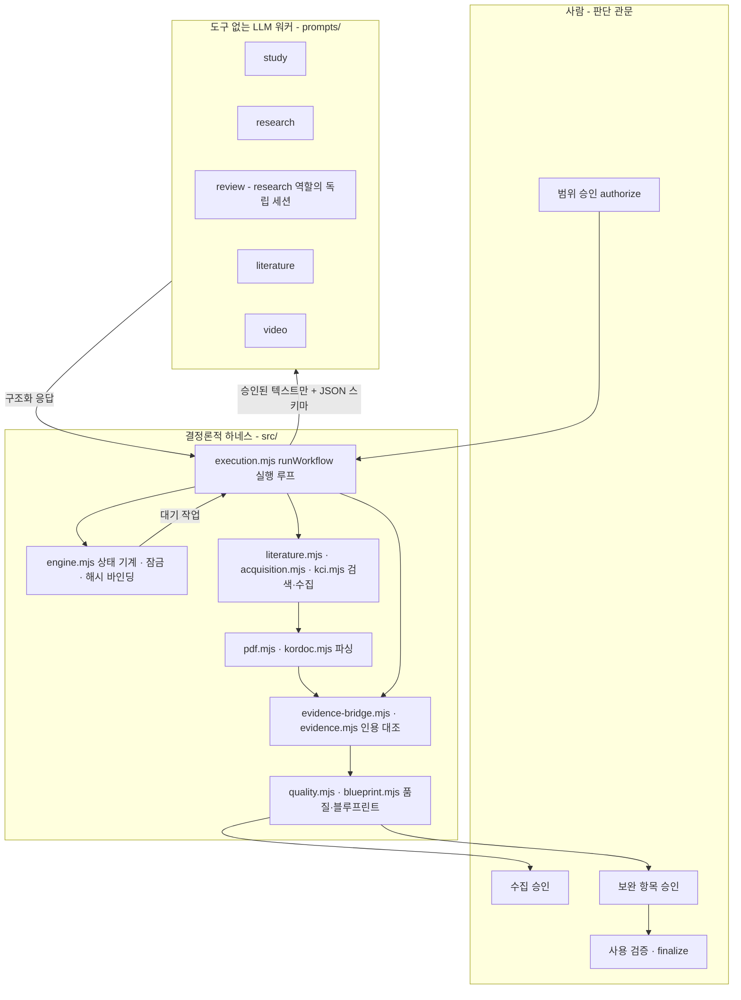
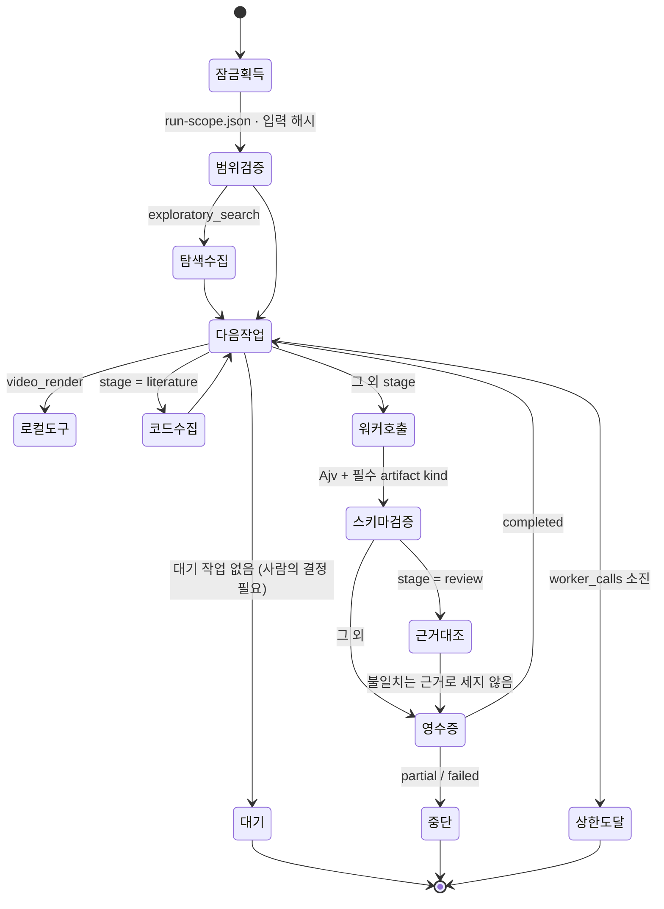

# 에이전트 설계

ROK는 "도구를 마음대로 쓰는 자율 에이전트"가 아니라 **결정론적 하네스(harness) 안에서 도구 없는 LLM 워커를 부리는 멀티 에이전트 오케스트레이터**입니다. 이 문서는 무엇이 모델의 판단이고 무엇이 코드의 책임인지, 역할·루프·실패 처리가 코드의 어디에 있는지를 정리합니다. 모든 설명은 `src/`의 실제 구현을 기준으로 합니다.

## 1. 한 장 요약

| 구분 | 담당 | 예 |
|---|---|---|
| 모델이 하는 일 (비결정적) | 역할별 LLM 워커 | 공부 노트·계획서 초안 작성, 독립 검토 보고서, 근거 장부(주장→쪽→인용) 제안, 보완본 작성, 영상 스토리보드 |
| 코드가 하는 일 (결정적) | 하네스 | 문헌 검색(Crossref·OpenAlex·KCI), 공개 원문 내려받기, PDF·HWP 파싱, SHA-256 바인딩, 인용 위치 대조, 상태 전이·잠금·재개, 승인 해시 검증, 예산·호출 상한 |
| 사람이 하는 일 | 연구자 | 범위 승인, 수집 승인, 보완 항목 승인, 사용 검증, `finalize` |

핵심 설계 결정: **워커에게 도구를 주지 않습니다.** Codex는 `exec --sandbox read-only --ephemeral`, Claude는 `-p --tools ''`로 실행되고(`src/execution.mjs`의 `runWorkflow`), 입력은 승인된 텍스트 파일만 프롬프트에 실립니다. 모델은 파일 내용만 돌려주고, 파일 쓰기·검색·승인·다음 작업 생성은 하네스가 합니다. 모델이 조작할 수 있는 표면을 줄여 주입 공격과 환각의 피해 범위를 제한하려는 선택입니다.

## 2. 구성 요소와 코드 위치

## 3. 역할 표

단계→역할 대응은 `src/engine.mjs`의 `ROLE_FOR_STAGE`(study→study, plan·review·revise→research, literature→literature, video_storyboard·video_render→video)이고, 역할 지침은 `prompts/*.md`, 호출은 `runWorkflow`, 산출물 종류는 `engine.completionTemplate()`와 `responseSchema()`가 강제합니다. review에는 별도 프롬프트 파일이 없고 research 역할 지침을 쓰되 독립 세션으로 실행됩니다.

| 역할 | 단계(stage) | 모델이 받는 것 | 모델이 내는 것 | 하네스가 대신하는 것 | 종료·실패 조건 |
|---|---|---|---|---|---|
| 기획팀장 (orchestrator) | 전체 | 사용자와 대화하는 계획 채팅이 `prompts/orchestrator.md`를 따름. 워커로 호출되지 않고 단계 전진은 **엔진·CLI가 강제** | 사용자 확인 기록(채팅 브리지 경유) | 작업 대기열 생성, 인계 기록, 승인 해시 검증. 담당 에이전트가 다음 작업을 임의로 만들 수 없음 | 사람의 명령으로만 단계 전진 |
| study | study | 사용자 입력, (탐색 수집이 있으면) 파싱된 문헌 | 공부 기록(supporting 노트) | 탐색 수집(검색·원문 파싱)은 코드가 먼저 실행해 파일로 제공 | 필수 산출물 누락 시 `partial` |
| research | plan, revise | 공부 기록, 사용자 결정, (revise) 검증된 근거 목록 | 계획서(Markdown) + 연구문제-자료-분석 대응표(JSON) | 대응표 문구를 계획서 원문에 고정(`anchorInPlan`·`installDesign`), 품질 보고서·DOCX 생성 | 초안은 초안 기준 검사에서 멈춤 |
| review (research 역할, **별도 세션**) | review | 승인된 계획서, 수집된 파싱 본문, 번호 붙은 계획서 문장 P1…, 출처 S1… | 검토 보고서 R1…, 근거 장부 제안(source_id·PDF쪽·인용) | 모델이 해시를 복사하지 않도록 `resolveEvidence`가 문서·파싱본 해시를 채움, `correctPages`가 쪽 번호 교정, `verifyEvidence`가 인용 대조 | 근거 부족은 실패가 아니라 **발견 사항**으로 보고하도록 지시 |
| literature | literature | 계획서, 승인된 검색어 | (실행 모드에서는 모델 호출 없음) | `searchLiterature`+`collectOpenAccess`가 검색·내려받기·제목 일치·파싱을 **코드로** 수행 | 매칭된 원문이 없으면 `partial`로 멈춤 |
| video | video_storyboard, video_render | 승인된 계획서·스토리보드·출처 지도 | 스토리보드·출처 지도 | 블루프린트 추출·렌더는 로컬 도구(`rok blueprint`/`render`) | 영상 승인 해시가 달라지면 무효 |

> 작성 세션과 검토 세션을 분리했지만 같은 모델 계열이 쓸 수 있습니다. 이 경우 공유 편향 가능성이 남습니다(AUTONOMY.md의 "한계" 참고). 그래서 검토자의 의미 판단은 근거로 세지 않고, **기계적으로 확인되는 위치 대조만** 근거로 계산합니다.

## 4. 에이전트 루프

`runWorkflow(root, {resume})`의 제어 흐름입니다.

한 번의 워커 호출 안에서 일어나는 일:

1. **입력 통제** – 범위 승인에 포함된 파일만 허용(`New input needs scope approval`), 텍스트(md/txt/json)만 전달, 500 KB 초과·민감정보 탐지 시 거부. 수집된 공개 논문은 이메일 등을 마스킹하고 150,000자로 자름.
2. **구조화 호출** – 단계별 필수 artifact kind를 enum으로 묶은 JSON 스키마를 모델에 강제(`responseSchema`). 입력 문서는 "신뢰할 수 없는 데이터"라고 프롬프트에 명시.
3. **응답 검증** – Ajv로 스키마 검증, 파일 30개·1 MB 상한, 파일명 경로 이탈 차단. "completed"라고 답했어도 필수 artifact가 빠지면 `partial`로 강등.
4. **검토 단계 후처리** – 모델이 낸 인용(source_id, PDF쪽, 인용문)을 하네스가 해시로 풀고(`resolveEvidence`), 쪽 번호를 교정하고(`correctPages`), 인용문이 해당 쪽에 실제로 있는지 대조(`verifyEvidence`). 실패한 인용은 사유와 함께 보고되고 **지지 근거로 계산하지 않음**.
5. **영수증과 이벤트 로그** – 입력·출력 해시를 `run-events.jsonl`에 남기고, 영수증(receipt)이 엔진에 기록되어야 다음 단계가 열림.

## 5. 설계 결정과 근거

| 결정 | 이유 | 코드 |
|---|---|---|
| 워커는 도구 없음 | 모델이 임의로 파일·네트워크·승인을 건드릴 수 없게 함 | `--tools ''`, `--sandbox read-only` |
| 모델은 해시·문장을 복사하지 않음 | 모델이 SHA-256이나 계획서 문장을 지어내는 오류 제거 | `evidence-bridge.mjs`의 `resolveEvidence`, `planSentences` |
| 모든 승인은 해시에 묶임 | 다른 버전의 승인을 승계하지 않음 | `engine.mjs` 승인 바인딩 |
| 근거 상태 4단계 | 확인 수준을 과장하지 않음 | `original_verified` · `parsed_verified` · `metadata_only` · `unverified` |
| 자동 검사·AI 판단·사람 확인을 분리 | 자동 통과를 연구 타당성으로 오해하지 않음 | `verifyEvidence`가 `semantic_review`·`human_review`를 별도 필드로 |
| 작업 단위 재개 | 사용량 한도·중단 후에도 완료 산출물을 보존 | `rok resume`, `active-worker.json`, claim 리스 |
| 유료 API 자동 전환 금지 | 비용·개인정보 통제 | `authorizeRun`에서 `api_budget` 0 강제 |

## 6. 이 설계가 하지 않는 것

- 연구 결과·인용·쪽수를 만들어 내지 않습니다.
- 모델의 의미 판단(주장이 인용을 정말 뒷받침하는가)을 자동으로 확정하지 않습니다. `semantic_verified`와 `human_verified`는 항상 `false`로 시작합니다.
- 스스로 완료를 선언하지 않습니다. 완료는 연구자의 `finalize`뿐입니다.
- 이 문서는 구조를 설명할 뿐 연구의 질을 보증하지 않습니다. 정량 검증은 [EVALUATION.md](EVALUATION.md), 자율성의 범위와 한계는 [AUTONOMY.md](AUTONOMY.md)를 보세요.
